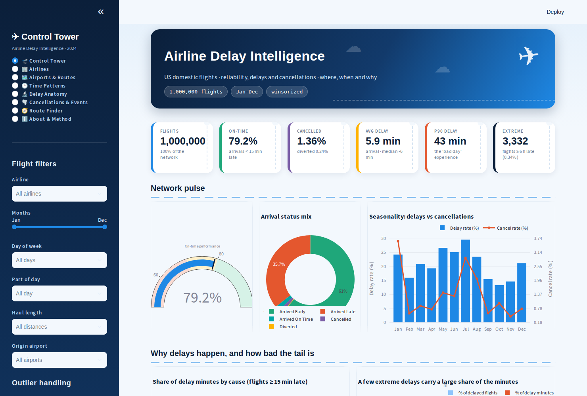
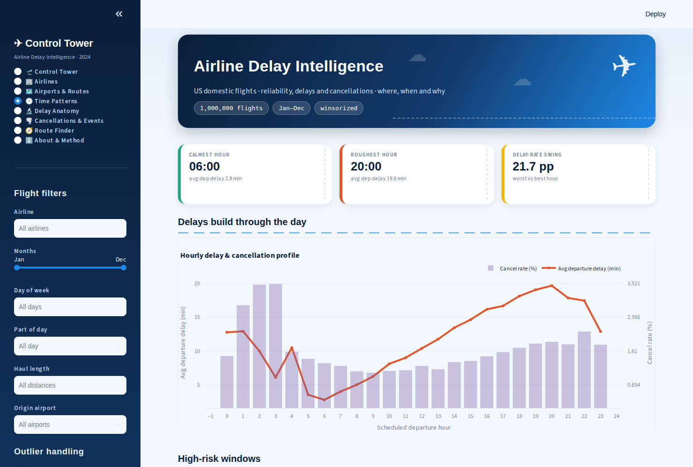
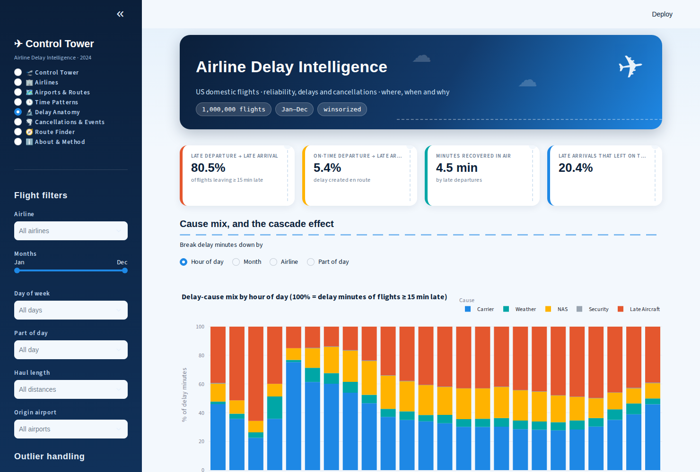
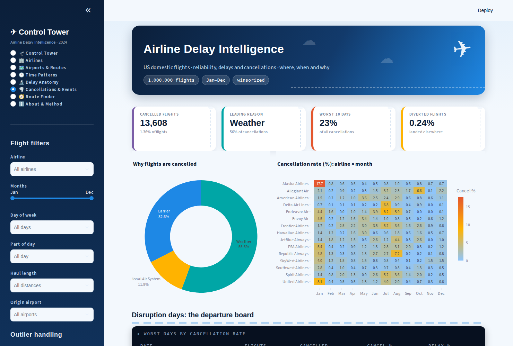

# ✈️ Airline Delay Intelligence

Production-grade analytics pipeline that turns **1 million 2024 US flight records** (a random sample of ~7M) into decisions on
**delay, cancellation and operational-reliability** - with tested code, a config-driven pipeline, explicit **outlier policy**,
28 interactive charts and an auto-generated insight report.

👉 **Start here: [`FINDINGS.md`](FINDINGS.md)** - key findings, recommendations, limitations and roadmap (all numbers from the real data).

---

## 🎯 Business problem

US airlines lose money, aircraft hours and customer loyalty every time a flight is late or cancelled.
Operations teams need to know **where, when and why** disruption happens - and which causes they can actually control.

> **How can an airline reduce arrival delays and cancellations by identifying which causes, carriers, airports,
> routes and time windows generate the most disruption?**

| Stakeholder | Decision supported |
|---|---|
| Network Operations Control | Where/when to add buffer, spare aircraft and crew |
| Schedule Planning | Which banks and rotations to re-time or de-peak |
| Station / Airport Managers | Where ground handling and turn performance need investment |
| Customer Experience | Which flights to proactively re-accommodate; cancellation drivers |
| Benchmark analysts | Like-for-like airline reliability comparison |

Full framing, KPIs, assumptions and limitations: [`docs/business_problem.md`](docs/business_problem.md)

## 📊 Dataset

BTS on-time performance, 2024 - [Kaggle: hrishitpatil/flight-data-2024](https://www.kaggle.com/datasets/hrishitpatil/flight-data-2024)
(1M-row random sample of ~7M flights, 15 carriers, 348 airports, 6,588 routes). The 186 MB CSV is **not** committed.
Place it at `data/raw/flight_random_1million.csv` (the file may be named `.xls` - it is really a CSV; just rename it). Column definitions: [`docs/data_dictionary.md`](docs/data_dictionary.md)

## 🚀 Quick start

```bash
git clone <repo> && cd airline-delay-intelligence
python -m venv .venv && source .venv/bin/activate
make install                      # pip install -e ".[dev]"

# Option A - real data
#   place flight_random_1million.csv in data/raw/
# Option B - SYNTHETIC demo data (simulated; never quote its numbers as real)
make sample

make run                          # clean -> features -> KPIs -> charts -> report
make test                         # 31 tests (incl. headless dashboard tests)
make dashboard                    # launch the interactive Streamlit dashboard
```

Outputs after `make run`:

| Path | Content |
|---|---|
| `data/processed/flights_clean.parquet` | Analysis-ready dataset (typed, cleaned, 60 columns) |
| `reports/insights.md` | Data-driven narrative (every number computed at run time) |
| `reports/tables/*.csv` | 18 KPI tables (airline, airport, route, hour, month, day, causes, severity, event days ...) |
| `reports/figures/*.html` | 28 interactive Plotly charts (~1.4 MB total) |
| `reports/data_quality_report.json` | Row counts, residual nulls, bounds, cause-sum consistency |

Useful flags: `python scripts/run_pipeline.py --nrows 100000 --skip-figures --config config/config.yaml`  (full 1M-row run ≈ 25 s)

## 🖥️ Interactive dashboard (Streamlit)

An airline "control tower" themed dashboard on top of the same tested KPI code as the pipeline:

```bash
make run          # once: builds data/processed/flights_clean.parquet
make dashboard    # or: streamlit run app/streamlit_app.py   -> http://localhost:8501
```



| Page | What you can do |
|---|---|
| 🛫 **Control Tower** | Boarding-pass KPI cards (vs network), on-time gauge, status mix, seasonality, delay causes, outlier impact |
| 🏢 **Airlines** | Rank by 7 metrics with **95 % confidence whiskers**, reliability scorecard, cause mix, CSV download |
| 🗺️ **Airports & Routes** | US airport map (bubble = volume, colour = metric), top-N rankings, departure-board of troubled routes |
| 🕒 **Time Patterns** | Hourly profile, month/weekday × hour heatmaps (3 metrics), weekday/day-part/season, daily timeline with event spikes |
| 🔬 **Delay Anatomy** | Cause mix by hour/month/airline/day-part (cascade effect), carry-over KPIs, distributions (log toggle), correlations |
| 🌪️ **Cancellations & Events** | Reasons, airline × month heatmap, disruption-day board, **drill into any date** |
| 🧭 **Route Finder** | Pick origin → destination: KPIs vs network, airline comparison, best/worst hours, monthly trend |
| ℹ️ **About & Method** | Business problem, KPI definitions, data quality, limitations |

**Global sidebar filters** (airline, month range, weekday, part of day, haul, origin airport) apply to every page, plus two
outlier switches: *exclude extreme delays (≥ 6 h)* and *winsorized vs raw averages*. All tables export to CSV.

<details><summary>More screenshots</summary>




</details>

Notes: the outline map and Google fonts load from the internet; without it use the *Plain lat/lon* map option (fonts fall back to the
system sans-serif). Airport coordinates are approximate and hand-entered for the busiest airports (`app/airports_geo.py`).
Interactive response is ~1 s per click on the full 1M rows (data cached, filters keyed and memoised).

## 🗂️ Project structure

```
airline-delay-intelligence/
├── FINDINGS.md                   # findings, recommendations, limitations, roadmap
├── app/                          # Streamlit dashboard (streamlit_app.py · views.py · data.py · theme.py · airports_geo.py)
├── .streamlit/config.toml        # dashboard theme
├── config/config.yaml            # paths, thresholds, outlier policy, lookups - nothing hard-coded in code
├── data/{raw,interim,processed}/ # raw is git-ignored
├── docs/
│   ├── business_problem.md       # stakeholders, decisions, KPIs, scope, limitations
│   ├── data_dictionary.md        # raw + engineered columns
│   └── changes_vs_original_notebooks.md
├── notebooks/
│   ├── 03_eda_walkthrough.ipynb  # thin notebook calling the package
│   └── archive/                  # original exploratory notebooks (kept for traceability)
├── reports/{figures,tables}/     # generated artefacts
├── scripts/
│   ├── run_pipeline.py           # CLI entry point
│   └── generate_sample_data.py   # synthetic data for demos / CI
├── src/airline_delay/
│   ├── config.py, logging_utils.py, pipeline.py
│   ├── data/          schema.py · loader.py · cleaning.py · synthetic.py
│   ├── features/      engineering.py · outliers.py
│   ├── analysis/      metrics.py · insights.py
│   └── visualization/ plots.py
├── tests/                        # unit + end-to-end tests
├── .github/workflows/ci.yml      # lint + tests on every push
├── pyproject.toml · requirements*.txt · Makefile
```

## 🔄 Pipeline

```
raw CSV ─► validate schema ─► clean ─► engineer features ─► KPI tables ─► charts + report
           (loader)           (cleaning)  (engineering)       (metrics)    (plots, insights)
```

1. **Validate** - fail fast if required columns are missing.
2. **Clean** - nullable integer types; HHMM → minutes since midnight; drop constant/duplicate rows; rebuild missing actual
   times for *completed* flights only (cancelled/diverted blanks are real information, never imputed); data-quality report.
3. **Features** - route, airline names, hour/day-part, weekend, season, haul length, status labels, DOT delay flag,
   primary delay cause, minutes recovered en route, cancellation reason, **outlier flags and winsorized delays**.
4. **Analyse** - pure KPI functions (`group_kpis`, `delay_cause_summary`, `pivot_metric`, ...).
5. **Report** - HTML charts and a markdown report generated from the computed tables.

## 📐 KPI definitions (US DOT convention)

| KPI | Definition |
|---|---|
| Delay rate | Completed flights arriving ≥ 15 min late ÷ completed flights |
| On-time % | 100 − delay rate |
| Cancel / divert rate | Cancelled (diverted) ÷ all scheduled flights |
| P90 arrival delay | 90th-percentile delay - the "bad day" customers remember, hidden by averages |
| Cause share | Delay minutes per cause ÷ total delay minutes, among flights delayed ≥ 15 min |

## 🧪 Outlier policy

Delay data is heavy-tailed (median arrival −6 min, but 74 flights were >24 h late). Extreme delays are real events, so **no rows are deleted**:

* flagged: `is_extreme_delay` (≥ 360 min), plus data-quality flags for impossible speeds, extreme taxi times and schedule/actual time mismatches;
* rankings use **winsorized means** (0.5-99.5 percentile caps computed from the data); raw means, medians and P90 are reported alongside;
* the impact is quantified: flights ≥ 6 h late are 0.34 % of flights but ~14 % of delay minutes.

Thresholds live in `config/config.yaml → outliers`.

## 🔎 Analyses covered

Univariate (volume, status mix, delay distributions, demand by hour) · Airline scorecard (delay vs cancel vs volume) ·
Airport/route bottlenecks (minimum-volume filtered) · Time patterns (hour, month, weekday × hour, month × hour) ·
Delay-cause mix (network, airline, month) · Cancellation reasons · Departure→arrival carry-over and time recovered by haul ·
Delay severity buckets (outlier impact), event-driven disruption days, hourly cause mix (cascade evidence), carry-over of departure delay,
Correlation of delay drivers.

## ✅ Quality engineering

* 31 tests, including headless tests that render every dashboard page and exercise filters, reset and empty selections, outlier-policy tests and a regression test for an int8-overflow bug that produced negative cancellation rates.
* Schema validation, plausibility-bound checks and cause-sum consistency in `data_quality_report.json`.
* Linted with `ruff`; CI on Python 3.10 and 3.12.
* Reproducible: fixed seeds, config-driven, no notebook execution-order dependencies.

## ⚠️ Limitations

Descriptive analysis only (association, not causation); sample not census; no tail number, weather or cost data.
See [`docs/business_problem.md`](docs/business_problem.md) §6-7 for details and the recommended next steps
(tail-number cascade analysis, weather/capacity joins, cost model, leakage-safe delay-prediction model).
